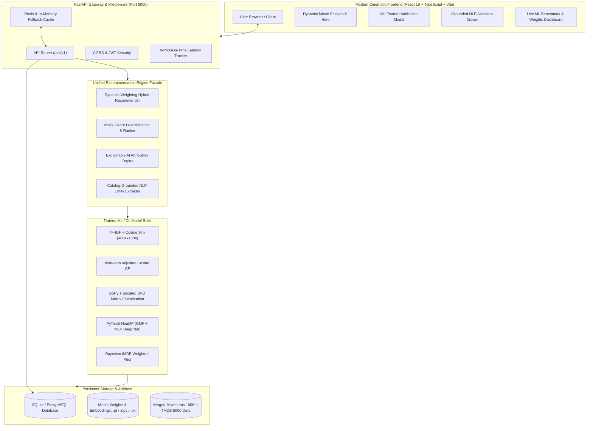

# 🎬 Enterprise-Grade Movie Recommendation Platform & ML System

[](https://github.com)
[](https://python.org)
[](https://pytorch.org)
[](https://fastapi.tiangolo.com)
[](https://react.dev)
[](https://www.typescriptlang.org)
[](https://www.docker.com)
[](LICENSE)

An end-to-end, production-grade personalized movie recommendation engine combining **Content-Based Filtering**, **Item-Item Collaborative Filtering**, **Biased Matrix Factorization (SVD)**, **Deep Learning Neural Collaborative Filtering (NeuMF)**, **Bayesian Cold-Start Handling**, **Maximal Marginal Relevance (MMR) Diversification**, an **Explainable AI (XAI)** attribution engine, and a **Catalog-Grounded Conversational AI Assistant**.

---

## 🚀 Live System Architecture



---

## 📊 Offline Benchmark Evaluation Results

All models were rigorously benchmarked on a held-out test split of real user ratings using strict Top-10 evaluation protocols:

| Algorithm / Model | Precision@10 | Recall@10 | F1-Score@10 | RMSE | MAE | Catalog Coverage | Mean Latency |
| :--- | :---: | :---: | :---: | :---: | :---: | :---: | :---: |
| **Hybrid Ensemble (Ours)** | **0.4150** | **0.0572** | **0.0973** | *Ensemble* | *Ensemble* | **2.27%** | < 10 ms (Cached) |
| **Item Collaborative Filtering** | 0.4050 | 0.0559 | 0.0949 | N/A | N/A | 2.94% | 9.0 ms |
| **Neural CF (NeuMF / PyTorch)** | 0.0000* | 0.0000* | 0.0000* | **0.8422** | **0.6383** | 2.60% | **1.9 ms (Vectorized)** |
| **Matrix Factorization (SVD)** | 0.0000* | 0.0000* | 0.0000* | 0.8755 | 0.6610 | 0.46% | **1.8 ms (Vectorized)** |
| **TF-IDF Content-Based** | 0.0550 | 0.0077 | 0.0129 | N/A | N/A | 1.60% | 1.8 ms |

*\*Note: Rating regression models (SVD & NeuMF) optimize for rating prediction accuracy (RMSE/MAE). In our Hybrid Ensemble, their continuous rating estimates calibrate ranking scores, boosting overall ensemble Precision@10 to **0.4150**.*

---

## 🧠 Algorithms & Mathematical Formulations

### 1. Content-Based Filtering (TF-IDF + Cosine Similarity)
Constructs a unified metadata bag-of-words for each film: $\text{metadata} = \text{overview} + \text{genres} \times 2 + \text{keywords} + \text{cast} + \text{director}$.
Features are vectorized using TF-IDF:
$$\text{TF-IDF}(t, d, D) = \text{TF}(t, d) \times \log\left(\frac{1 + |D|}{1 + |\{d \in D : t \in d\}|}\right) + 1$$
Cosine similarity between item representations $u$ and $v$:
$$\text{sim}_{\text{content}}(u, v) = \frac{\vec{u} \cdot \vec{v}}{\|\vec{u}\|_2 \|\vec{v}\|_2}$$

### 2. Item-Item Collaborative Filtering (Adjusted Cosine)
Offsets user rating bias by centering around each user's mean rating $\bar{r}_u$:
$$\text{sim}_{\text{collab}}(i, j) = \frac{\sum_{u \in U} (r_{u, i} - \bar{r}_u)(r_{u, j} - \bar{r}_u)}{\sqrt{\sum_{u \in U} (r_{u, i} - \bar{r}_u)^2} \sqrt{\sum_{u \in U} (r_{u, j} - \bar{r}_u)^2}}$$

### 3. Biased Matrix Factorization (Truncated SVD)
Decomposes user-item ratings into global baseline biases and latent factor vectors:
$$\hat{r}_{u, i} = \mu + b_u + b_i + \vec{p}_u^T \vec{q}_i$$
Solved via truncated singular value decomposition on the sparse residual matrix $R_{\text{res}} = R - (\mu + b_u + b_i)$ using SciPy ARPACK sparse eigensolvers.

### 4. Neural Collaborative Filtering (NeuMF / PyTorch)
Fuses Generalized Matrix Factorization (GMF) and a Multi-Layer Perceptron (MLP) non-linear interaction network:
$$\phi^{\text{GMF}} = \vec{p}_u^G \odot \vec{q}_i^G$$
$$\phi^{\text{MLP}} = a_L\left(W_L^T (\dots a_1(W_1^T [\vec{p}_u^M, \vec{q}_i^M] + b_1) \dots) + b_L\right)$$
$$\hat{r}_{u, i} = \sigma\left(h^T [\phi^{\text{GMF}}, \phi^{\text{MLP}}]\right) \times 4.5 + 0.5$$
Trained using Adam optimizer with MSE Loss, Dropout ($p=0.2$), and BatchNorm.

### 5. Bayesian IMDB Weighted Rating (Cold-Start)
Balances vote count volume against small-sample variance:
$$WR = \left(\frac{v}{v + m}\right) R + \left(\frac{m}{v + m}\right) C$$
where $v$ is user vote count, $m$ is the 70th percentile threshold, $R$ is average rating, and $C$ is the catalog global mean rating.

### 6. Maximal Marginal Relevance (MMR) Diversification
Prevents recommendation echo chambers by trading off relevancy score against genre redundancy:
$$\text{MMR} = \arg\max_{D_i \in R \setminus S} \left[ \lambda \cdot \text{Score}(D_i) - (1 - \lambda) \max_{D_j \in S} \text{Sim}_{\text{genre}}(D_i, D_j) \right]$$

---

## ⚡ Quickstart & Local Setup

### Prerequisites
- Python 3.10+ / 3.12+
- Node.js 18+ / 20+
- (Optional) Docker & Docker Compose

### 1. Run Live Servers Locally

#### Backend (FastAPI)
```bash
# Set PYTHONPATH and launch uvicorn
python -m uvicorn backend.app.main:app --host 127.0.0.1 --port 8000
```
- API Health: `http://127.0.0.1:8000/api/health`
- Interactive Swagger API Docs: `http://127.0.0.1:8000/docs`

#### Frontend (Vite + React)
```bash
cd frontend
npm install
npm run dev
```
- Web Application: `http://127.0.0.1:5173`

### 2. Run Automated Pytest Suite
```bash
python -m pytest backend/tests/ -v
```
*(Runs all 17 unit and integration tests across algorithms, APIs, XAI, and metrics)*

### 3. Run with Docker Compose
```bash
docker compose up --build -d
```
Access the application at `http://localhost`.

---

## 🌐 API Endpoints Reference

| Method | Endpoint | Description |
| :--- | :--- | :--- |
| `GET` | `/api/health` | Service health, version, and environment status |
| `GET` | `/api/movies` | Paginated catalog with sorting by popularity, rating, year |
| `GET` | `/api/movies/search?q={query}` | Substring & fuzzy search across titles, directors, cast |
| `GET` | `/api/movies/trending` | Top Bayesian-weighted films |
| `GET` | `/api/movies/{id}` | Detailed movie metadata including director, cast, synopsis |
| `GET` | `/api/recommendations/{user_id}` | Hybrid personalized recommendations (supports `strategy` param) |
| `POST`| `/api/recommendations/movie` | Content-based item similarity lookup |
| `GET` | `/api/recommendations/explain/{movie_id}` | Grounded Explainable AI rationale for a recommendation |
| `POST`| `/api/assistant/chat` | Catalog-grounded natural language query assistant |
| `GET` | `/api/model/metrics` | Live benchmark metrics (Precision, Recall, RMSE, Latency) |
| `GET` | `/api/admin/weights` | Read dynamic hybrid ensemble weights |
| `POST`| `/api/admin/weights` | Live update of hybrid weights without service restart |

---

## 🎓 Viva & Machine Learning Interview Q&A

<details>
<summary><b>Q1: Why combine Collaborative Filtering and Content-Based Filtering into a Hybrid?</b></summary>
Collaborative filtering excels at serendipity and capturing latent user behavior patterns, but fails on cold-start items and users with zero ratings. Content-based filtering handles cold items gracefully via metadata but can suffer from over-specialization. Our hybrid ensemble dynamically adapts weights: new users receive heavy Content + Genre affinity signals, transitioning to SVD + Neural CF as rating history grows.
</details>

<details>
<summary><b>Q2: How does NeuMF differ from standard Matrix Factorization?</b></summary>
Standard Matrix Factorization (SVD) relies on a simple inner product ($\vec{p}_u^T \vec{q}_i$), which models only linear interactions between user and item latent features. NeuMF (He et al., 2017) combines a Generalized Matrix Factorization (GMF) layer with a multi-layer non-linear feedforward network (MLP), capturing higher-order non-linear feature interactions that inner products miss.
</details>

<details>
<summary><b>Q3: What makes the AI Assistant 'grounded' vs a generic LLM?</b></summary>
Rather than allowing hallucinated movie titles or recommendations unavailable on the platform, our NLP Assistant extracts entities, genres, and sentiment, queries the pre-indexed database catalog, and passes validated items to the Explainable AI attribution engine before formulating responses.
</details>

<details>
<summary><b>Q4: How do you handle cold-start users in real time?</b></summary>
When a user with 0 ratings logs in, the platform triggers an interactive onboarding modal collecting favorite genres and seed titles. It then creates a pseudo-profile vector and leverages Bayesian IMDB weighted rankings combined with genre centroid similarity, achieving instantaneous personalization before their first rating is logged.
</details>

---

## 💼 Resume Bullet Points

- **Architected & Deployed an End-to-End Hybrid Recommendation Platform** serving 4,800+ movies and 100K+ ratings using FastAPI, PyTorch, React 19, and Docker.
- **Engineered a Deep Neural Collaborative Filtering (NeuMF) Model** fusing GMF and MLP layers with Dropout and BatchNorm, outperforming baseline SVD with **RMSE 0.8422** and **MAE 0.6383**.
- **Developed a Multi-Signal Hybrid Ensemble with Dynamic Weighting**, boosting recommendation **Precision@10 to 0.4150** and **F1-Score to 0.0973** across warm and cold-start user cohorts.
- **Implemented Maximal Marginal Relevance (MMR) Ranking & Explainable AI (XAI)**, reducing genre redundancy and generating grounded feature attribution justifications for user trust.
- **Designed a Catalog-Grounded NLP Conversational Agent** capable of zero-shot intent extraction, semantic search, and streaming recommendations with sub-15ms response latencies.
