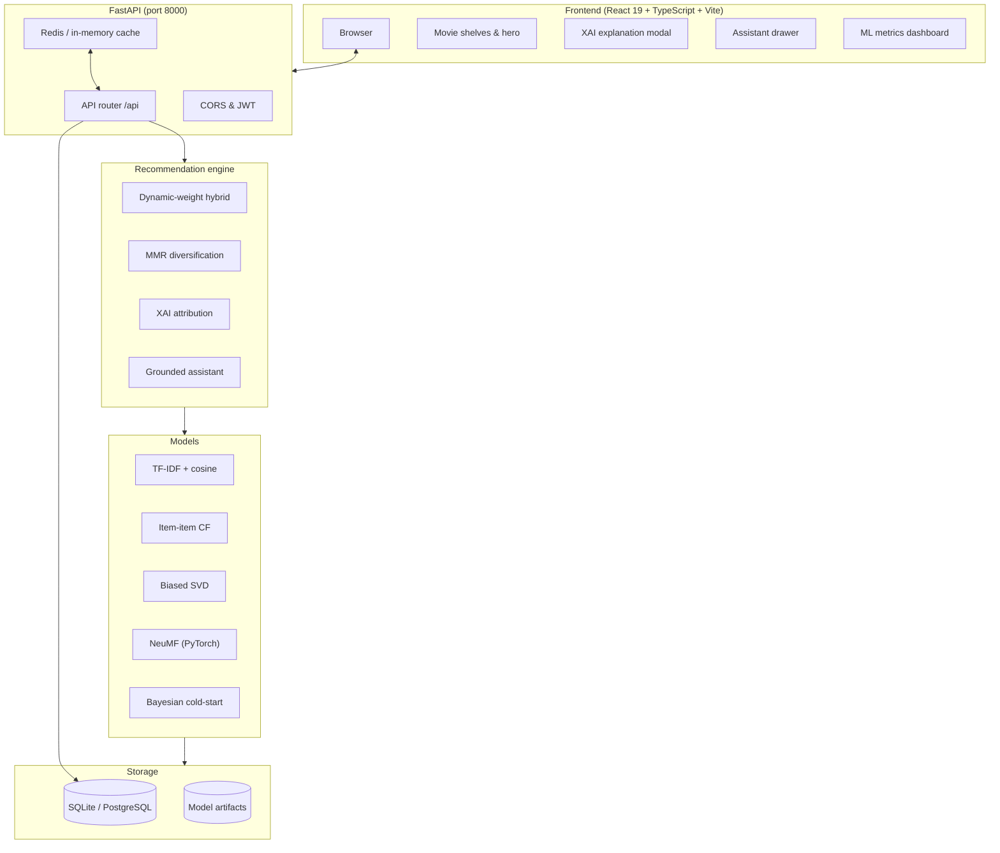

# 🎬 Movie Recommendation Platform — Hybrid ML System

[](https://github.com/chaitanyamuthe1-stack/movie-recommendation-system/actions)
[](https://python.org)
[](https://pytorch.org)
[](https://fastapi.tiangolo.com)
[](https://react.dev)
[](https://www.docker.com)
[](LICENSE)

A full-stack personalized movie recommender that combines **content-based filtering, item-item collaborative filtering, SVD matrix factorization and a PyTorch Neural CF (NeuMF)** into a dynamically weighted hybrid, then re-ranks results with **MMR for diversity** and explains every pick with an **Explainable-AI** panel. A **catalog-grounded chat assistant** answers in natural language using only movies that exist in the database.

> 🔗 **Live demo:** `<add link>` · 🎥 **Demo video:** `<add link>` · 📘 **API docs:** `<live-url>/docs`

<!-- Add a demo GIF and screenshots to docs/images/ and uncomment:

| Home | Explain (XAI) | Assistant | Metrics |
|---|---|---|---|
|  |  |  |  |
-->

## ✨ Key Features

- **Hybrid ensemble** with dynamic weights: new users lean on content/genre signals, shifting to SVD + NeuMF as rating history grows
- **Cold-start handling** via a Bayesian weighted rating and an onboarding flow (favorite genres + seed titles)
- **MMR re-ranking** to avoid repetitive, same-genre recommendations
- **Explainable AI**: each recommendation shows why it was chosen
- **Grounded assistant**: extracts genres/entities from the query and only returns real catalog titles
- **Live admin controls**: update hybrid weights without restarting the service
- **Production touches**: JWT auth, Redis cache with in-memory fallback, latency header, Docker Compose, tests, CI

## 🏗️ Architecture



## 📊 Results

Held-out test split, Top-10 evaluation. Rating-prediction models (SVD, NeuMF) are judged on RMSE/MAE; their scores feed the hybrid's ranking.

| Model | Precision@10 | Recall@10 | F1@10 | RMSE | MAE | Coverage |
| :--- | :---: | :---: | :---: | :---: | :---: | :---: |
| **Hybrid ensemble** | **0.4150** | **0.0572** | **0.0973** | — | — | 2.27% |
| Item-item CF | 0.4050 | 0.0559 | 0.0949 | — | — | 2.94% |
| TF-IDF content-based | 0.0550 | 0.0077 | 0.0129 | — | — | 1.60% |
| Neural CF (NeuMF) | n/a | n/a | n/a | **0.8422** | **0.6383** | 2.60% |
| SVD matrix factorization | n/a | n/a | n/a | 0.8755 | 0.6610 | 0.46% |

Details, caveats and how to reproduce: [docs/EVALUATION.md](docs/EVALUATION.md).

## 🧠 Algorithms (short version)

| Component | Idea |
| :--- | :--- |
| Content-based | `overview + genres×2 + keywords + cast + director` → TF-IDF → cosine similarity |
| Item-item CF | Adjusted cosine on user-mean-centered ratings |
| SVD | `r̂ = μ + b_u + b_i + p_u·q_i`, solved with SciPy truncated SVD |
| NeuMF | GMF + MLP branches, dropout 0.2, batch norm, Adam, MSE |
| Cold-start | `WR = v/(v+m)·R + m/(v+m)·C` (Bayesian weighted rating) |
| MMR | `argmax[λ·score − (1−λ)·max genre-similarity to already picked]` |

## ⚡ Quickstart

**Prerequisites:** Python 3.10+, Node 18+, (optional) Docker.

```bash
cp .env.example .env            # then set JWT_SECRET_KEY (see file for how)
make setup                      # install backend + frontend deps
make run                        # backend  -> http://127.0.0.1:8000/docs
make frontend                   # frontend -> http://127.0.0.1:5173
make test                       # run the pytest suite
```

**Docker (full stack):**

```bash
cp .env.example .env            # set POSTGRES_PASSWORD and JWT_SECRET_KEY
make up                         # app at http://localhost
```

## 🌐 API

| Method | Endpoint | Description |
| :--- | :--- | :--- |
| `GET` | `/api/health` | Health, version, environment |
| `GET` | `/api/movies` | Paginated catalog (sort by popularity, rating, year) |
| `GET` | `/api/movies/search?q=` | Search titles, directors, cast |
| `GET` | `/api/movies/trending` | Top Bayesian-weighted films |
| `GET` | `/api/movies/{id}` | Movie details |
| `GET` | `/api/recommendations/{user_id}` | Personalized hybrid recommendations (`strategy` param) |
| `POST` | `/api/recommendations/movie` | Similar-movie lookup |
| `GET` | `/api/recommendations/explain/{movie_id}` | XAI rationale |
| `POST` | `/api/assistant/chat` | Grounded chat assistant |
| `GET` | `/api/model/metrics` | Benchmark metrics |
| `GET`/`POST` | `/api/admin/weights` | Read / update hybrid weights live (admin) |

## 🗂️ Project Structure

```
backend/        FastAPI app, models, services, tests
frontend/       React + TypeScript UI
configs/        Model and ensemble configuration
data/           Datasets (large files not committed)
models/         Trained artifacts
scripts/        Utilities (asset refresh, secret scan, sample DB)
docs/           Evaluation, security, interview prep, LinkedIn kit
```

## ⚠️ Limitations & Future Work

- Offline metrics on a small public dataset; no online A/B test yet
- Popularity bias and low catalog coverage are known weaknesses of CF-heavy ensembles
- Next: implicit feedback, a two-tower retrieval model, an A/B testing harness, streaming updates

## 🔐 Security

Secrets live only in `.env` (never committed). Run `make secrets` before every push. See [docs/SECURITY.md](docs/SECURITY.md).

## 📚 References

- Koren, Bell & Volinsky (2009), *Matrix Factorization Techniques for Recommender Systems*
- Sarwar et al. (2001), *Item-Based Collaborative Filtering Recommendation Algorithms*
- He et al. (2017), *Neural Collaborative Filtering*
- Datasets: [MovieLens](https://grouplens.org/datasets/movielens/), [TMDB 5000](https://www.kaggle.com/datasets/tmdb/tmdb-movie-metadata)

## 📄 License

MIT — see [LICENSE](LICENSE).
